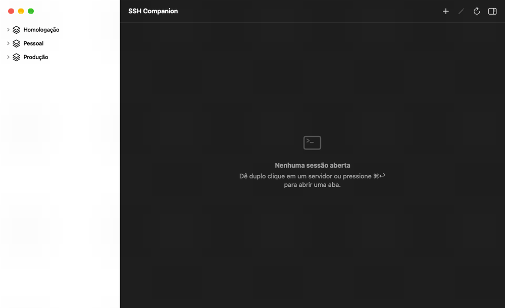

# SSH Companion

Gerenciador de servidores SSH nativo para macOS. Cadastre servidores em workspaces e
diretórios, abra sessões em abas e painéis, e conecte-se pelo Raycast digitando `ssh nome`.



Construído em Swift e SwiftUI, com [SwiftTerm](https://github.com/migueldeicaza/SwiftTerm) como
emulador de terminal e [libSQL](https://github.com/tursodatabase/libsql-swift) para persistência.
O `ssh` usado é o do sistema (`/usr/bin/ssh`), rodando em um pseudo-terminal: `~/.ssh/config`,
ssh-agent e chaves funcionam como no Terminal.

## Funcionalidades

### Servidores

- Árvore de **workspaces → diretórios → servidores**, com aninhamento livre de diretórios.
- Autenticação por **senha** ou **chave privada** (com ou sem passphrase). Segredos ficam no
  **Keychain**; o arquivo de configuração nunca contém senhas.
- Importação de servidores do **`~/.ssh/config`** e de droplets da **DigitalOcean**.
- **Picker rápido** (⌘O): busca por nome, host ou caminho e conecta pelo teclado.
- **Anotações por servidor** (⌘⇧J). Linhas que começam com `$ ` viram **snippets** no menu da
  toolbox; há também uma nota global de snippets.
- **Histórico de sessões** (⌘⇧H) com o transcript de cada conexão.

### Terminal

- Abas com indicador de estado (conectando, conectado, desconectado) e **info bar** com
  usuário, host, IP resolvido, processo em primeiro plano e diretório atual (OSC 7).
- **Painéis divididos** na vertical ou horizontal. Cada painel é uma sessão independente,
  com servidor próprio e toolbox própria. Arraste uma aba para a área do terminal para
  encaixá-la como painel; arraste o gap entre painéis para redimensionar.
- **Busca no terminal** (⌘F) com contador de ocorrências e opção de maiúsculas/minúsculas.
- **Renomear** e **colorir abas**, útil para distinguir produção de homologação.
- **Modo foco** (⌘⇧↩): esconde sidebar, inspector e info bar.
- Senha e passphrase são preenchidas automaticamente ao detectar o prompt do `ssh`.

### Toolbox do painel

Cada painel tem uma barra de ferramentas; em painéis estreitos ela vira um menu "⋯".

| Grupo           | Ferramentas                                                                                                                                  |
| --------------- | -------------------------------------------------------------------------------------------------------------------------------------------- |
| Sessão          | Reconectar, duplicar aba, dividir, fechar painel, enviar sinal (⌃C, ⌃D, ⌃Z, ⌃\), keep-alive, **broadcast** para abas marcadas                |
| Aba             | Renomear, cor da aba                                                                                                                         |
| Arquivos e rede | Abrir em **SFTP** no diretório atual, **transferir arquivo** por scp, **túnel rápido** (`ssh -L`), abrir `http(s)://host:porta` no navegador |
| Texto           | Copiar, colar (com confirmação para várias linhas), selecionar tudo, snippets, enviar arquivo como texto                                     |
| Tela            | Limpar, diminuir/aumentar fonte, modo foco, busca, **latência** medida a cada 15 s                                                           |

Transferências por scp e túneis abrem em uma aba própria, usando as mesmas credenciais da
sessão. Fechar a aba encerra o túnel.

### Integração com o Raycast

- O app registra o esquema `sshcompanion://`. `sshcompanion://connect?server=cabana` abre uma
  aba conectada; a busca aceita nome exato, prefixo, trecho e subsequência (`cbn` → `cabana`).
- O app exporta `~/Library/Application Support/SSHCompanion/servers.json` (sem credenciais).
  A extensão em [`raycast/`](raycast/) lê esse índice: digite `ssh cabana` no Raycast e,
  se um único servidor casar, ele conecta direto; senão a lista aparece filtrada.

## Atalhos de teclado

| Atalho               | Ação                                        |
| -------------------- | ------------------------------------------- |
| ⌘N                   | Novo servidor no contêiner selecionado      |
| ⌘⌥N                  | Novo diretório                              |
| ⌘⇧N                  | Novo workspace                              |
| ⌘E                   | Editar item selecionado                     |
| ⌘⌫                   | Excluir item selecionado                    |
| ⌘R                   | Recarregar a árvore                         |
| ⌘O                   | Picker rápido de servidores                 |
| ⌘↩                   | Conectar ao servidor selecionado            |
| Duplo clique / Enter | Conectar ao servidor da árvore              |
| ⌘T                   | Reconectar a aba ativa                      |
| ⌘W                   | Fechar aba                                  |
| ⌘⇧W                  | Fechar janela                               |
| ⌘D                   | Dividir na vertical (novo painel ao lado)   |
| ⌘⇧D                  | Dividir na horizontal (novo painel abaixo)  |
| ⌘F                   | Buscar no painel em foco                    |
| ↩ / ⇧↩               | Próxima / anterior ocorrência da busca      |
| Esc                  | Fechar a busca                              |
| ⌘⇧↩                  | Modo foco                                   |
| ⌘⇧] / ⌘⇧[            | Próxima / aba anterior                      |
| ⌘1 … ⌘9, ⌘0          | Abas 1 a 10                                 |
| ⌘⇧H                  | Histórico de sessões                        |
| ⌘⇧J                  | Anotações do servidor                       |
| ⌘C / ⌘V / ⌘A         | Copiar, colar e selecionar tudo no terminal |

## Instalação

Requer macOS 27 ou mais recente e Xcode 27 (deployment target do projeto).

```sh
Scripts/install.sh            # build Release, instala em /Applications e importa a extensão do Raycast
Scripts/install.sh --no-raycast
```

O script também registra o esquema `sshcompanion://` para a cópia instalada. Para a extensão do
Raycast é preciso ter Node.js; ela é importada em modo desenvolvimento (`ray develop`).

## Desenvolvimento

```sh
# Build e testes unitários
xcodebuild -project SSHCompanion.xcodeproj -scheme SSHCompanion -skipPackagePluginValidation \
  -destination 'platform=macOS' test -only-testing:SSHCompanionTests
```

- `--ui-testing` troca persistência, Keychain e conexão SSH por versões em memória, com um
  shell falso que responde a `ls`, `uptime`, `df -h` e `docker ps`.
- `--demo-seed` preenche a árvore com servidores de exemplo.
- `--demo-record` com `DEMO_OUTPUT_DIR=<pasta>` grava as capturas usadas no GIF acima:

```sh
open -n -W --env DEMO_OUTPUT_DIR=/tmp/demo -a build/Release/Build/Products/Release/SSHCompanion.app \
  --args --ui-testing --demo-seed --demo-record
ffmpeg -framerate 1/1.8 -i /tmp/demo/%02d-*.png -vf "scale=1000:-1" docs/demo.gif
```

### Estrutura

```
SSHCompanion/
├── Models/            Workspace, Directory, Server, TreeItem
├── Services/
│   ├── Persistence/   libSQL (servidores, histórico, anotações) e índice JSON
│   ├── Keychain/      CredentialStore
│   └── SSH/           ssh/scp em PTY, PromptResponder, tarefas (shell, túnel, cópia)
├── State/             ServerStore, SessionManager, NotesStore, CommandRouter, LayoutState
└── Views/             Sidebar, Terminal (abas, painéis, toolbox), Forms, History
raycast/               Extensão do Raycast
Scripts/install.sh     Build, instalação e extensão
```

## Licença

MIT.
